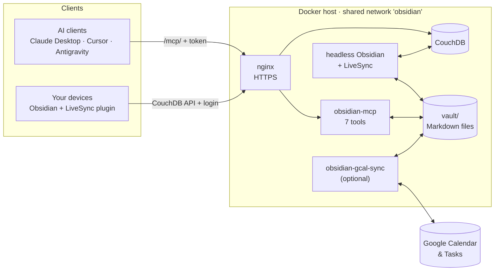

# Obsidian LiveSync MCP

[](https://github.com/prod-explore/OBSIDIAN-LIVESYNC/actions/workflows/ci.yml)


A self-hosted Obsidian vault that **AI agents can read and edit through MCP**. Your devices sync it through your own CouchDB (Self-hosted LiveSync), and an optional service keeps it in step with **Google Calendar and Google Tasks**.

What is different: the MCP server assumes **the client is a language model** that can be wrong and can be prompt-injected by what it reads. So it has seven small tools, checks every path (no `..`, no symbolic links out, no `.obsidian/`), never destroys a note without a copy in `.trash/`, has no shell, and sits behind one token.

Try the MCP server on its own in about a minute (Node 22; no Docker, no Obsidian):

```bash
git clone https://github.com/prod-explore/OBSIDIAN-LIVESYNC.git && cd OBSIDIAN-LIVESYNC && npm ci && npm run build
mkdir -p demo-vault && echo '# Hello' > demo-vault/Hello.md
MCP_API_KEY=dev VAULT_PATH="$PWD/demo-vault" node packages/mcp/dist/index.js    # then, in a second terminal:
curl -s localhost:3000/mcp/sse -H 'Authorization: Bearer dev' -H 'Content-Type: application/json' -H 'Accept: application/json, text/event-stream' \
  -d '{"jsonrpc":"2.0","id":1,"method":"tools/call","params":{"name":"get_path","arguments":{"path":"Hello.md"}}}'
```



## What is in the box

Three parts that work together and can be used apart. The MCP server and the sync are independent TypeScript packages (strict mode) in one npm workspace: each has its own Dockerfile and tests, and neither imports the other. They only meet in the vault folder. The repository is named after the first part, which is where it started.

| Part | Service | What it does |
|---|---|---|
| **LiveSync** | `obsidian-couchdb`, `obsidian-headless` | Your devices sync notes through your own CouchDB ([Self-hosted LiveSync](https://github.com/vrtmrz/obsidian-livesync)); a headless Obsidian running the same plugin turns the database into plain Markdown files. Images only, nothing to build: [`docker-compose.yml`](docker-compose.yml) |
| **MCP server** | [`obsidian-mcp`](packages/mcp) | Seven tools over those files, over Streamable HTTP and legacy SSE |
| **Google sync** (optional) | [`obsidian-gcal-sync`](packages/gcal-sync) | Two-way sync of Google Calendar events and Google Tasks with Markdown notes in the vault |

## Safety by design

| Concern | What this project does |
|---|---|
| Leaving the vault | Every path a client sends goes through `resolveVaultPath()`: `..`, absolute paths **and symbolic links** that lead out (or nowhere) are refused, for reads and for writes. Search and folder walks never follow links. Unit-tested against real links on disk, and through the tools themselves. |
| Hidden files | Paths through a hidden file or folder are refused too, also behind a link. `.obsidian/` holds the LiveSync plugin's CouchDB password and plugin code that headless Obsidian runs; an agent can neither read the one nor plant the other. |
| Destroying a note | `delete_note` moves to `.trash/`. `write_note` and `move_note` refuse to overwrite unless told to, and the replaced file goes to `.trash/` first; `edit_note` leaves a copy of the previous version there too. Writes are rate limited (120 a minute by default). Each acts on one note: a folder is refused, so nothing is deleted or moved recursively. No tool can run a command. |
| A wrong `move_note` | Backlinks are rewritten, but a link that is only a name is left alone when another note shares it (it may mean the other one), and files whose content would not change are not touched, so LiveSync does not re-upload them. |
| Authentication | Bearer header or `?token=`, compared in constant time over SHA-256 hashes. The server refuses to start without `MCP_API_KEY`. Legacy SSE posts its messages to `/mcp/messages` with the session id an authenticated `GET /mcp/sse` handed out (the MCP SDK's scheme). OAuth discovery answers with a plain 404. |
| Network | Compose publishes no ports. Your reverse proxy exposes two things: `/mcp/` (the token) and CouchDB for LiveSync (CouchDB's own login). |
| Containers | The MCP server and the sync run as an unprivileged user, with a read-only root filesystem, all capabilities dropped and `no-new-privileges`. Required secrets are enforced by compose (`:?`). |
| A vault that is suddenly empty | The sync would read that as "the user deleted everything" and delete it on Google, where Tasks has no undo. A **mass-deletion guard** refuses to delete most of a list in one cycle until you say so (`ALLOW_MASS_DELETE`). |
| Crashes | Sync state is written atomically; a corrupt file is kept aside rather than overwritten; a stopped container lets a running cycle finish; an insert interrupted halfway is recognised on the next cycle. |
| A note the sync cannot understand | Front matter is read into typed notes. A `due` that is not a date, an unknown `status` or broken YAML skips that one note, says why in `status.json` and the log, and never looks like a deletion (nothing is deleted on Google in a cycle where part of the vault could not be read). |
| Secrets in logs | One structured logger for both services. `?token=` and other secret URL parameters, bearer tokens, secret keys quoted in JSON text and any field named like a secret (at any depth) are masked; a rejected request is logged with its path and never its query string or header. Tests pin that down. |
| Dependencies | `npm audit` on runtime dependencies gates CI; images are built in CI; a secret scan and CodeQL run on every push to `main` and every pull request. |

## Quick start (the whole stack)

You need Docker with Compose, a domain pointing at the host for HTTPS, and Obsidian on at least one device.

```bash
git clone https://github.com/prod-explore/OBSIDIAN-LIVESYNC.git && cd OBSIDIAN-LIVESYNC
cp .env.example .env                 # fill in the required secrets: openssl rand -base64 32
docker network create obsidian       # shared with your reverse proxy
docker compose up -d --build couchdb obsidian-headless obsidian-mcp
```

The Google sync is a fourth service that needs Google credentials first; [set it up](#google-calendar--tasks-sync) once the rest works. (A plain `docker compose up -d` starts it too, and without credentials it stops at once and is restarted in a loop.)

1. **Vault.** Headless Obsidian needs a one-time setup through its GUI: create the vault `vault-mcp` in `/vault`, install the LiveSync plugin, point it at CouchDB, fetch. Steps (with the SSH tunnel) in [`docs/operations.md`](docs/operations.md#setting-up-the-vault).
2. **HTTPS.** [`deploy/nginx-obsidian.conf.example`](deploy/nginx-obsidian.conf.example) proxies `/mcp/` to the MCP server (no buffering, long timeouts, token kept out of the access log) and everything else to CouchDB for LiveSync.
3. **Check.** `curl -H "Authorization: Bearer $MCP_API_KEY" https://obsidian.example.com/mcp/health` returns `{"status":"ok","vaultPath":…,"vaultExists":true,…}`.
4. **Connect a client** (below).

### Connecting a client

Claude Desktop, Cursor, Cline, Antigravity — anything that speaks MCP over HTTP:

```json
{
  "mcpServers": {
    "obsidian": {
      "type": "sse",
      "url": "https://obsidian.example.com/mcp/sse?token=YOUR_MCP_API_KEY"
    }
  }
}
```

Clients that can send headers should use `Authorization: Bearer YOUR_MCP_API_KEY` instead and leave the token out of the URL. Both transports share the endpoint: `POST /mcp/sse` is Streamable HTTP (stateless, one server per request), `GET /mcp/sse` is legacy SSE (one isolated server per connection, closed after about an hour so abandoned connections cannot pile up; clients reconnect).

## MCP tools

| Tool | Arguments | Notes |
|---|---|---|
| `get_path` | `path` (default: vault root) | Reads a note, or lists a folder's immediate children. One tool instead of two keeps the schema small. |
| `get_vault_tree` | `path`, `depth` (default 1, `-1` = unlimited) | Path listing only, no content. Skips dotfiles and `.trash/`. The tool description asks agents to call it on first contact and after idling, so they do not act on stale paths. |
| `search_notes` | `query` | Case-insensitive match on file names and content. Stops at 100 results and says so. |
| `write_note` | `path`, `content`, `overwrite` (default `false`) | Creates folders as needed. Replacing an existing note moves the old one to `.trash/`. |
| `edit_note` | `path`, `start_line`, `end_line`, `new_content` | Replaces a line range (1-indexed, inclusive). `end_line = start_line - 1` inserts; empty `new_content` deletes the lines. The previous version is copied to `.trash/` first. |
| `move_note` | `from`, `to`, `overwrite` (default `false`) | Atomic rename of one note; rewrites backlinks (wikilinks with headings and aliases, and Markdown links). |
| `delete_note` | `path` | Soft delete of one note into `.trash/`, timestamp-prefixed. |

On connect every client gets the tool list and one line pointing it at `_Systems/AGENTS.md`, your own file with the vault's structure and rules; the server never creates or edits it. `MCP_INSTRUCTIONS` changes that line (`none` removes it). Other settings are listed in [`docs/operations.md`](docs/operations.md#mcp-server).

## Google Calendar & Tasks sync

Optional. `obsidian-gcal-sync` polls every few minutes (`POLL_INTERVAL_MINUTES`, 1–59) and keeps Markdown notes and Google in step.

- **Layout.** Folder names are literal, braces included: tasks live in `{Tasks}/` (a subfolder is a Google task list, created if missing), events in `{Calendar}/YYYY-MM/YYYY-MM-DD-HHMM-Title-shortId.md` (`0000` for all-day events). Renaming or re-dating an event moves its file and rewrites every `[[wikilink]]` to it.
- **What syncs.** Only frontmatter: `title`, `status`, `start`/`end` (events), `due` (tasks) and `description`. Reminders are mirrored into frontmatter too. **The Markdown body is never read from or written to Google**, in either direction — it is yours and your agent's space for context.
- **First sync.** The first pull of a calendar looks back seven days; events more than two years ahead are not brought in.
- **Archiving.** Completed or cancelled tasks move to `04-Archive/{Tasks}/`; events move to `04-Archive/{Calendar}/…` once their whole month has passed, and come back if that reverses.
- **Conflicts.** Last write wins, per note and not per field: if a note was edited locally while Google changed too, the side changed more recently wins all synced fields. When Google's wins, `_Systems/sync-conflicts.md` records which note lost, with its whole front matter and the time of the local edit, so nothing the edit set is lost. The body is never touched.
- **Deletions.** A task deleted or an event cancelled on Google only marks the note cancelled locally. Deleting the note deletes the record on Google (behind the mass-deletion guard above), and that deletion does not come back as a note.
- **One item, one note.** If two notes carry the same `google_id` (a copy made in Obsidian, a LiveSync conflict copy, a move that was interrupted), the one changed last stays — a copy you edited here counts as the newest — and the other is moved to `_Systems/duplicates/` and written to the conflict log. It is moved, not deleted: its body may hold text that exists nowhere else.
- **Cancelled notes expire.** A note marked cancelled stays as a record. When its body is empty and its last change on Google is `CANCELLED_RETENTION_DAYS` days old (30; `0` keeps them), it is removed. A note with anything written in its body never is.
- **When something goes wrong.** An item that cannot be applied is logged and skipped without blocking the others, and the sync does not move its progress marker past it, so it is fetched again next cycle. An expired Google sync token (they do expire) restarts that calendar with a full sync. Task lists created in Google later are picked up on the next cycle. After every cycle the sync writes `status.json` (when it last succeeded, how many errors, which notes need fixing and why) and the container's health check reads it.
- **Google Tasks has no "cancelled".** A task note marked `cancelled` in Obsidian stays a vault-side state: it is archived and expires like the others, but Google keeps the task.

Setup: create a Google Cloud project, enable the Calendar and Tasks APIs and create an OAuth client (Desktop app). Put `GOOGLE_CLIENT_ID` and `GOOGLE_CLIENT_SECRET` into `.env`, then get a refresh token on a machine with a browser:

```bash
npm ci && npm run get-token --workspace packages/gcal-sync   # reads .env, listens on localhost:3000 for Google's redirect
```

Add the printed `GOOGLE_REFRESH_TOKEN` to `.env` and run `docker compose up -d --build obsidian-gcal-sync`. `docker inspect --format '{{json .State.Health}}' obsidian-gcal-sync` then says when the sync last succeeded.

Known limits: the `{Tasks}`, `{Calendar}` and `04-Archive` folder names are fixed, the sync is for one Google account, and conflicts are resolved per note (above), never merged.

## Development

```bash
npm ci
npm test                         # strict type-check, build and every test of both packages
npm run test:coverage            # the same, failing below each package's coverage floor (c8, .c8rc.json)
npm run lint                     # ESLint, type-aware: no `any`, no unawaited promises, no console
npm run format:check             # Prettier
```

`npm test` runs 216 tests (135 for the sync, 81 for the MCP server, as `node --test` counts them). CI runs all of that, plus `npm audit` on runtime dependencies, a check that both copies of `logger.ts` are identical, a Docker build of each image, a validation of the compose file and a secret scan; CodeQL runs in its own workflow, and Dependabot proposes dependency, base-image and Action updates. The tests include real symbolic links on disk, an HTTP-level suite for the server (auth, both transports, the list of tools, what its log does and does not contain), every tool against a real temporary vault, and the whole sync (ingest, push, full cycles and the status file) run against in-memory stand-ins for the Google APIs, including a simulated vault outage, expired tokens, failing writes, duplicate notes and notes with broken front matter.

How the sync is put together: `sync/ingest.ts` pulls from Google, `sync/push/` (tasks, events, and the walk they share) pushes the vault's changes, `markdown/notes.ts` turns a parsed note into a typed one, and every step takes one `SyncContext` (config, state, clients, logger, the cycle's report). `cycle.ts` runs them in order and writes `status.json`.

Conventions for changing or adding tools — especially what this project will never hand to an agent — are in [`AGENTS.md`](AGENTS.md). Running it day to day (backups, recovering notes, file ownership, logs) is in [`docs/operations.md`](docs/operations.md). Reporting a vulnerability: [`SECURITY.md`](SECURITY.md).

## License

[MIT](LICENSE)
