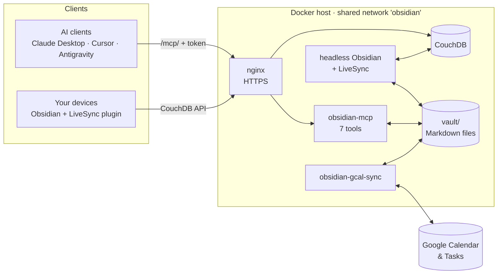

# Obsidian LiveSync MCP

[](https://github.com/prod-explore/OBSIDIAN-LIVESYNC/actions/workflows/ci.yml)


A self-hosted Obsidian vault that **AI agents can read and edit through MCP**, and that **stays in sync with Google Calendar and Google Tasks**. Your notes live in your own CouchDB, on your own machine; the only thing exposed to the network is one authenticated endpoint.

It is built around one assumption: **the client is a language model**. It can be wrong, and it can be prompt-injected by whatever it reads. So the tools are deliberately small, every path is checked, nothing is destroyed without a way back, and there is no shell.

## What is in the box

| Service | What it does |
|---|---|
| `obsidian-couchdb` | The database behind [Self-hosted LiveSync](https://github.com/vrtmrz/obsidian-livesync): your devices sync notes through it |
| `obsidian-headless` | Obsidian itself, headless, running the LiveSync plugin to turn the database into plain Markdown files |
| [`obsidian-mcp`](mcp-src) | The MCP server: seven tools over those files (Streamable HTTP and legacy SSE) |
| [`obsidian-gcal-sync`](gcal-sync-src) | Two-way sync of Google Calendar events and Google Tasks with Markdown notes in the vault |



## Safety by design

| Concern | What this project does |
|---|---|
| Leaving the vault | Every path goes through `resolveVaultPath()`: `..`, absolute paths **and symbolic links** that lead out (or nowhere) are refused, for reads and for writes. Search and folder walks never follow links. Unit-tested against real links on disk. |
| Destroying a note | `delete_note` moves to `.trash/`. `write_note` and `move_note` refuse to overwrite unless told to, and the replaced file goes to `.trash/` first. No tool deletes or moves recursively, and none can run a command. |
| A wrong `move_note` | Backlinks are rewritten, but a link that is only a name is left alone when another note shares it (it may mean the other one), and files whose content would not change are not touched, so LiveSync does not re-upload them. |
| Authentication | Bearer header or `?token=`, compared in constant time over SHA-256 hashes. The server refuses to start without `MCP_API_KEY`. OAuth discovery answers with a plain 404. |
| Containers | The MCP server and the sync run as an unprivileged user, with a read-only root filesystem, all capabilities dropped and `no-new-privileges`. Required secrets are enforced by compose (`:?`). |
| A vault that is suddenly empty | The sync would read that as "the user deleted everything" and delete it on Google, where Tasks has no undo. A **mass-deletion guard** refuses to delete most of a list in one cycle until you say so (`ALLOW_MASS_DELETE`). |
| Crashes | Sync state is written atomically; a corrupt file is kept aside rather than overwritten; a stopped container lets a running cycle finish. |
| Dependencies | `npm audit` on runtime dependencies gates CI; images are built in CI; a secret scan runs on every push. |

## Quick start

You need Docker with Compose, a domain pointing at the host for HTTPS, and Obsidian on at least one device.

```bash
git clone https://github.com/prod-explore/OBSIDIAN-LIVESYNC.git && cd OBSIDIAN-LIVESYNC
cp .env.example .env                 # fill in the required secrets: openssl rand -base64 32
docker network create obsidian       # shared with your reverse proxy
docker compose up -d --build
```

Without Google Calendar and Tasks sync, start just the first three services:
`docker compose up -d couchdb obsidian-headless obsidian-mcp`.

1. **Vault.** Headless Obsidian needs a one-time setup through its GUI: create the vault `vault-mcp` in `/vault`, install the LiveSync plugin, point it at CouchDB, fetch. Steps (with the SSH tunnel) in [`docs/operations.md`](docs/operations.md#setting-up-the-vault).
2. **HTTPS.** [`deploy/nginx-obsidian.conf.example`](deploy/nginx-obsidian.conf.example) proxies `/mcp/` to the MCP server (no buffering, long timeouts, token kept out of the access log) and everything else to CouchDB for LiveSync.
3. **Check.** `curl "https://obsidian.example.com/mcp/health?token=$MCP_API_KEY"` returns `{"status":"ok","vaultPath":…,"vaultExists":true,…}`.
4. **Connect a client** (below).

### Connecting a client

Claude Desktop, Cursor, Cline, Antigravity — anything that speaks MCP over HTTP:

```json
{
  "mcpServers": {
    "obsidian": {
      "type": "sse",
      "url": "https://obsidian.example.com/mcp/sse?token=YOUR_MCP_API_KEY"
    }
  }
}
```

Clients that can send headers should use `Authorization: Bearer YOUR_MCP_API_KEY` instead and leave the token out of the URL. Both transports share the endpoint: `POST /mcp/sse` is Streamable HTTP (stateless, one server per request), `GET /mcp/sse` is legacy SSE (one isolated server per connection, closed after at most an hour so abandoned connections cannot pile up; clients reconnect).

## MCP tools

| Tool | Arguments | Notes |
|---|---|---|
| `get_path` | `path` (default: vault root) | Reads a note, or lists a folder's immediate children. One tool instead of two keeps the schema small. |
| `get_vault_tree` | `path`, `depth` (default 1, `-1` = unlimited) | Path listing only, no content. Skips dotfiles and `.trash/`. Agents are told to call it on first contact and after idling, so they do not act on stale paths. |
| `search_notes` | `query` | Case-insensitive match on file names and content. Stops at 100 results and says so. |
| `write_note` | `path`, `content`, `overwrite` (default `false`) | Creates folders as needed. Replacing an existing note moves the old one to `.trash/`. |
| `edit_note` | `path`, `start_line`, `end_line`, `new_content` | Replaces a line range (1-indexed, inclusive). `end_line = start_line - 1` inserts; empty `new_content` deletes the lines. |
| `move_note` | `from`, `to`, `overwrite` (default `false`) | Atomic rename; rewrites backlinks (wikilinks with headings and aliases, and Markdown links). |
| `delete_note` | `path` | Soft delete into `.trash/`, timestamp-prefixed. |

On connect every client gets the tool list and one line pointing it at `_Systems/AGENTS.md`, your own file with the vault's structure and rules; the server never creates or edits it. `MCP_INSTRUCTIONS` changes that line (`none` removes it). Other settings are listed in [`docs/operations.md`](docs/operations.md#mcp-server).

## Google Calendar & Tasks sync

`obsidian-gcal-sync` polls every few minutes (`POLL_INTERVAL_MINUTES`, 1–59) and keeps Markdown notes and Google in step.

- **Layout.** Folder names are literal, braces included: tasks live in `{Tasks}/` (a subfolder is a Google task list, created if missing), events in `{Calendar}/YYYY-MM/YYYY-MM-DD-HHMM-Title-shortId.md` (`0000` for all-day events). Renaming or re-dating an event moves its file and rewrites every `[[wikilink]]` to it.
- **What syncs.** Only frontmatter: `title`, `status`, `start`/`end` (events), `due` (tasks) and `description`. Reminders are mirrored into frontmatter too. **The Markdown body is never read from or written to Google**, in either direction — it is yours and your agent's space for context.
- **Archiving.** Completed or cancelled tasks move to `04-Archive/{Tasks}/`; events move to `04-Archive/{Calendar}/…` once their whole month has passed, and come back if that reverses.
- **Conflicts.** If a note was edited locally while Google changed too, Google wins and your version is appended to `_Systems/sync-conflicts.md`. A deletion on Google only marks the note cancelled locally; deleting the note deletes the record on Google (behind the mass-deletion guard above).

Setup: create a Google Cloud project, enable the Calendar and Tasks APIs and create an OAuth client (Desktop app). Put `GOOGLE_CLIENT_ID` and `GOOGLE_CLIENT_SECRET` into `.env`, then get a refresh token on a machine with a browser:

```bash
cd gcal-sync-src && npm ci && npm run get-token   # reads ../.env, listens on localhost:3000 for Google's redirect
```

Add the printed `GOOGLE_REFRESH_TOKEN` to `.env` and run `docker compose up -d --build obsidian-gcal-sync`.

Known limits: the `{Tasks}`, `{Calendar}` and `04-Archive` folder names are fixed, and the sync is for one Google account.

## Development

```bash
cd mcp-src && npm ci && npm test            # strict type-check, build, 58 tests
cd gcal-sync-src && npm ci && npm test      # strict type-check, build, 30 tests
```

CI runs both, plus `npm audit` on runtime dependencies, a Docker build of each image, a validation of the compose file and a secret scan. The tests include real symbolic links on disk, an HTTP-level suite for the server (auth, both transports, the list of tools) and a simulated vault outage for the sync.

Conventions for changing or adding tools — especially what this project will never hand to an agent — are in [`AGENTS.md`](AGENTS.md). Running it day to day (backups, recovering notes, file ownership, logs) is in [`docs/operations.md`](docs/operations.md).

## License

[MIT](LICENSE)
